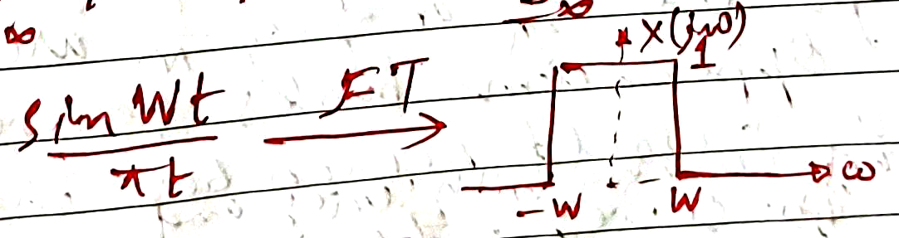
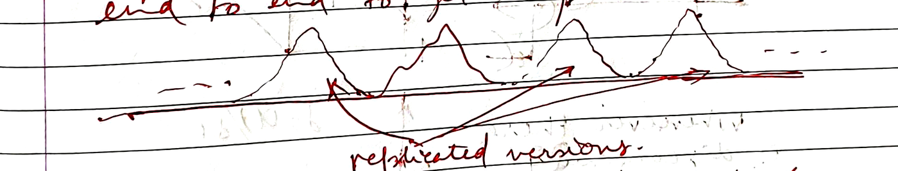
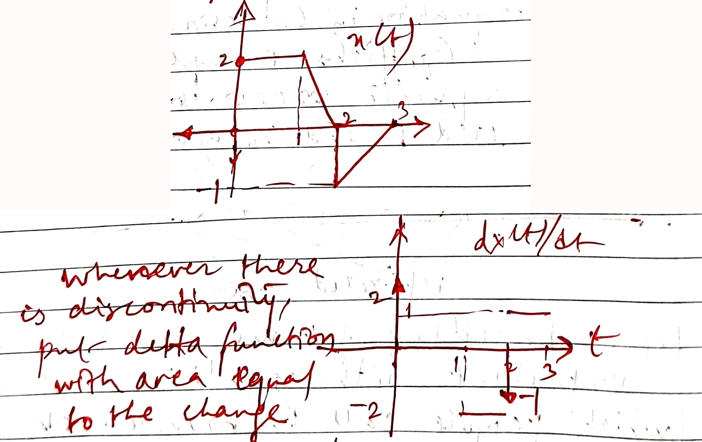
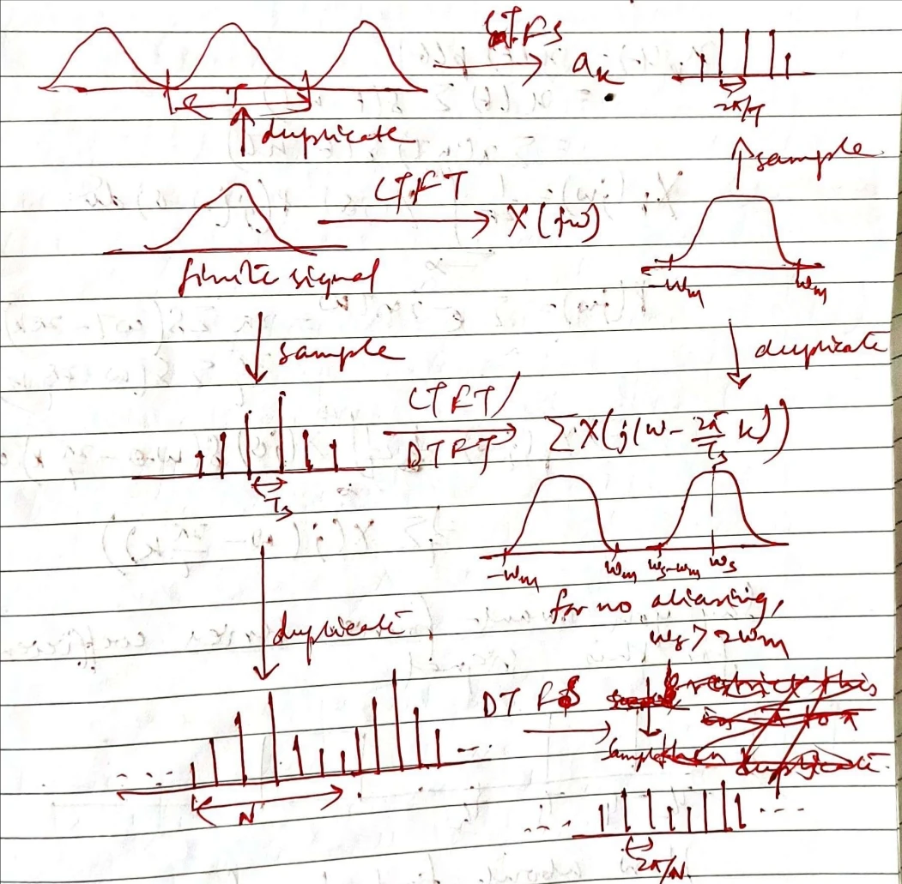

Since my first-year, I have been hearing profs say Fourier series and Fourier transforms, and I have always wished to learn them properly. Finally, I did this semester.

I am writing this to preserve all that I learnt in this semester. This writeup may not be sufficient to learn the topic from scratch, but it can be taken up as a quick reference for revising the topic. You can practice questions from Oppenheim to get comfortable. I will be dividing it into two sections:

1. My last-minute formula list which I revised before going to the exam hall.
2. Subtle but important facts which I learnt through the course.

I will follow Oppenheim's convention throughout.

---

## Part I: Last-minute formula sheet

These are some formulas which are not that intuitive and take time to derive, so I would rather keep them in mind.

**1. Sum of complex exponentials**

$$
\sum_{n=-\infty}^{\infty} e^{-j\Omega n}
= 2\pi \sum_{k=-\infty}^{\infty} \delta(\Omega - 2\pi k)
$$

**2. A limit which gives the impulse**

$$
\lim_{T\to\infty} \frac{\sin(\omega T)}{\omega}
= \pi\,\delta(\omega)
$$

This is useful while finding the Fourier transform of the unit step. The integral is understood in the distribution sense (or by adding a small exponential damping term):

$$
\int_0^{\infty} e^{-j\omega t}\,dt
= \operatorname{PV}\!\left(\frac{1}{j\omega}\right) + \pi\delta(\omega)
\quad\Longrightarrow\quad
u(t)\;\xleftrightarrow{\;\mathcal F\;}\;
\operatorname{PV}\!\left(\frac{1}{j\omega}\right) + \pi\delta(\omega)
$$

**3. Parseval's relation**

$$
\int_{-\infty}^{\infty} |x(t)|^2\,dt
= \frac{1}{2\pi}\int_{-\infty}^{\infty} |X(j\omega)|^2\,d\omega
$$

$$
\sum_{k=-\infty}^{\infty} |a_k|^2
= \frac{1}{T}\int_T |x(t)|^2\,dt
$$

**Trick:** See where the $1/2\pi$ or $1/T$ appears in the transform pair. For CTFT, the inverse transform has $1/2\pi$, so Parseval has $1/2\pi$ with the frequency-domain integral. For CTFS, the coefficient formula has $1/T$, so Parseval has $1/T$ with the time-domain integral.

**4. Sinc function and rectangular spectrum**

$$
\frac{\sin Wt}{\pi t}
\;\xleftrightarrow{\;\mathcal F\;}\;
X(j\omega)=
\begin{cases}
1, & |\omega| < W\\
0, & |\omega| > W
\end{cases}
$$

**5. Multiplication in time is convolution in frequency**

$$
x(t)\,y(t)
\;\xleftrightarrow{\;\mathcal F\;}\;
\frac{1}{2\pi}\int_{-\infty}^{\infty}
X(j\theta)\,Y\big(j(\omega-\theta)\big)\,d\theta
$$

Notice the $1/2\pi$ factor here. Multiplication in time becomes convolution in frequency, and this is the scaling factor that comes with it in Oppenheim's convention.

---

## Part II: Subtle but important facts

### The four Fourier representations

Firstly, let me state the basic formulas. Let $\omega_0 = 2\pi/T$ for continuous time.

| | Synthesis (reconstruct the signal) | Analysis (find the spectrum) |
|---|---|---|
| **CTFS** (continuous-time Fourier series) | $x(t) = \displaystyle\sum_{k=-\infty}^{\infty} a_k\,e^{jk\frac{2\pi}{T}t}$ | $a_k = \dfrac{1}{T}\displaystyle\int_T x(t)\,e^{-jk\frac{2\pi}{T}t}\,dt$ |
| **DTFS** (discrete-time Fourier series) | $x[n] = \displaystyle\sum_{k=\langle N\rangle} a_k\,e^{jk\frac{2\pi}{N}n}$ | $a_k = \dfrac{1}{N}\displaystyle\sum_{n=\langle N\rangle} x[n]\,e^{-jk\frac{2\pi}{N}n}$ |
| **CTFT** (continuous-time Fourier transform) | $x(t) = \dfrac{1}{2\pi}\displaystyle\int_{-\infty}^{\infty} X(j\omega)\,e^{j\omega t}\,d\omega$ | $X(j\omega) = \displaystyle\int_{-\infty}^{\infty} x(t)\,e^{-j\omega t}\,dt$ |
| **DTFT** (discrete-time Fourier transform) | $x[n] = \dfrac{1}{2\pi}\displaystyle\int_{2\pi} X(e^{j\omega})\,e^{j\omega n}\,d\omega$ | $X(e^{j\omega}) = \displaystyle\sum_{n=-\infty}^{\infty} x[n]\,e^{-j\omega n}$ |

Here, $\langle N\rangle$ means any $N$ consecutive integer values, and $\int_{2\pi}$ means integration over any interval of length $2\pi$.

Notice the duality in CTFT. The forward and inverse relations look almost identical, and this can save us from doing some difficult integrals.

$$
x(t) \xleftrightarrow{\;\mathcal F\;} X(j\omega)
\quad\Longrightarrow\quad
X(jt) \xleftrightarrow{\;\mathcal F\;} 2\pi\,x(-\omega)
$$

For example, when you get an integral involving a sinc function, sometimes you can use duality instead of integrating it directly.

**How I remember the constants:** The $1/2\pi$, $1/T$ and $1/N$ are just Oppenheim's convention, but I would remember them like this:

- In a **series**, the signal is the starting point. We get the series coefficients after that. So there is no scaling factor in $x(t)$ or $x[n]$, while the coefficient formula has one.
- In a **transform**, the transform is the main object, so there is no scaling factor in the transform relation. The inverse relation has the scaling factor.
- The frequency-domain relations always have a negative sign in the exponential. The inverse relations have a positive sign.

### Which representation for which signal?

CTFS and DTFS are applied to periodic signals, while CTFT and DTFT are applicable to aperiodic signals. Strictly speaking, the usual integral and sum definitions require suitable convergence conditions. We can also extend the idea to periodic and other power signals by allowing impulses in the spectrum.

Notice that the frequency spectrum is discrete in CTFS and DTFS, and continuous in CTFT and DTFT. In discrete time, the frequency spectrum is also periodic with period $2\pi$ for both DTFS and DTFT.

CTFS and DTFS can also be applied to a finite-duration signal, that is, a signal which is zero everywhere except in some interval $[a,b]$. We replicate copies of the signal end to end to get a periodic version, and then find its Fourier series. The series matches the original signal over the interval. This comes up while solving Laplace's equation in Cartesian coordinates (see Griffiths, *Introduction to Electrodynamics*, Example 3.3).

### Orthogonality relations (Fourier's trick)

Before proceeding, let me write down some important orthogonality relations. People often call this the Fourier trick.

$$
\int_0^T e^{jk\frac{2\pi}{T}t}\,dt = T\,\delta[k]
$$

$$
\int_{-\infty}^{\infty} e^{j\omega t}\,dt = 2\pi\,\delta(\omega)
$$

$$
\sum_{n=0}^{N-1} e^{jk\frac{2\pi}{N}n}
= N\delta[k \% N]
$$

The last sum is $N$ when $k$ is a multiple of $N$, and zero otherwise. To remember this, recall that the sum of the $N$-th roots of unity is zero. For example, $1+\omega+\omega^2=0$ for the cube roots of unity.

### A quick revision of Dirac delta functions

(Just for fun, remember the electromagnetism result $\nabla\cdot\left(\dfrac{\hat{\mathbf r}}{r^2}\right)=4\pi\,\delta^{(3)}(\mathbf r)$.)

Some useful properties:

1. **Sampling:** $x(t)\,\delta(t-t_0)=x(t_0)\,\delta(t-t_0)$
2. **Shifting:** $x(t)*\delta(t-t_0)=x(t-t_0)$
3. **Scaling:** $\delta(at)=\dfrac{1}{|a|}\,\delta(t)$

**Example: taking derivatives.** Whenever there is a discontinuity, put a delta function with area equal to the change. In the intervals where the signal is continuous, just take the ordinary derivative.

Here the signal jumps from $0$ to $2$ at $t=0$, remains at $2$ until $t=1$, slopes down to $0$ at $t=2$, jumps to $-1$, and then slopes up to $0$ at $t=3$. So its derivative is

$$
\frac{dx(t)}{dt}
= 2\,\delta(t) - \delta(t-2)
- 2\big[u(t-1)-u(t-2)\big]
+ \big[u(t-2)-u(t-3)\big]
$$

### The big picture: how the four representations connect

Now moving onto some interesting observations.

- **Periodic in one domain means discrete in the other.** Repeating a signal in time samples its spectrum.
- **Discrete in one domain means periodic in the other.** Sampling a signal in time repeats its spectrum.

Start from a finite-duration signal $x(t)$ and its transform $X(j\omega)$:

- **Repeat it in time** with period $T$. The result is periodic, and its CTFS coefficients are samples of $X(j\omega)$ spaced $2\pi/T$ apart.
- **Sample it in time** every $T_s$. The spectrum becomes repeated copies of $X(j\omega)$, with spacing $\omega_s=2\pi/T_s$.
- **Do both** (sample and then repeat every $N$ samples). The spectrum becomes both discrete and periodic. This is the DTFS.

It is useful to know the derivation. Let $\tilde{x}(t)$ be one period of the signal, and let it be zero outside $[0,T]$. Then

$$
a_k = \frac{1}{T}\int_0^T x(t)\,e^{-jk\frac{2\pi}{T}t}\,dt,
\qquad
\tilde X(j\omega)=\int_0^T x(t)\,e^{-j\omega t}\,dt
$$

$$
\Longrightarrow\quad
\boxed{\,a_k=\frac{1}{T}\,\tilde X(j\omega)\Big|_{\omega=\frac{2\pi k}{T}}\,}
$$

The discrete-time version works in the same way: take the DTFT of one period and sample it at $\omega=2\pi k/N$, then divide by $N$.

### Sampling

Model sampling as multiplying the signal by an impulse train $p(t)$:

$$
\begin{aligned}
x_p(t) &= x(t)\,p(t)\\
&= x(t)\sum_{n=-\infty}^{\infty}\delta(t-nT_s)\\
&= \sum_{n=-\infty}^{\infty}x(nT_s)\,\delta(t-nT_s)
\end{aligned}
$$

Multiplication in time is convolution in frequency, so

$$
X_p(j\omega)
= \frac{1}{2\pi}\int_{-\infty}^{\infty}
X(j\theta)\,P\big(j(\omega-\theta)\big)\,d\theta
$$

The transform of the impulse train follows from the exponential-sum identity:

$$
\begin{aligned}
P(j\omega)
&= \sum_n e^{-j\omega nT_s}\\
&= 2\pi\sum_k\delta(\omega T_s-2\pi k)\\
&= \frac{2\pi}{T_s}\sum_k
\delta\!\left(\omega-\frac{2\pi k}{T_s}\right)
\end{aligned}
$$

Substitute this into the convolution integral. Each delta function picks out one shifted copy of the original spectrum:

$$
\boxed{\,X_p(j\omega)
= \frac{1}{T_s}\sum_{k=-\infty}^{\infty}
X\!\left(j\left(\omega-\frac{2\pi k}{T_s}\right)\right)\,}
$$

So the spectrum of the sampled signal is the original spectrum scaled by $1/T_s$ and repeated every $\omega_s=2\pi/T_s$.

For no aliasing, the shifted copies must not overlap. If the signal is band-limited to $|\omega|<\omega_M$, we require

$$
\omega_s > 2\,\omega_M
$$

If the sampling frequency is lower than this, the copies overlap. This is called **aliasing**, and we cannot perfectly recover the original signal from these overlapping copies.

### Worked example: Fourier series of a periodic square wave

Say we want the Fourier series coefficients of a periodic signal with period $T$, which is $1$ for $|t|<T_1$ and zero elsewhere in one period. Instead of directly finding the series coefficients, how about finding the transform of one pulse and then sampling it?

For one pulse, on $[-T_1,T_1]$,

$$
\begin{aligned}
\tilde X(j\omega)
&= \int_{-T_1}^{T_1} e^{-j\omega t}\,dt\\
&= \left.\frac{e^{-j\omega t}}{-j\omega}\right|_{-T_1}^{T_1}\\
&= \frac{e^{-j\omega T_1}-e^{j\omega T_1}}{-j\omega}\\
&= \frac{2\sin(\omega T_1)}{\omega}
\end{aligned}
$$

We already know that the CTFS coefficients are samples of this transform at $\omega=2\pi k/T$, divided by $T$. Therefore,

$$
\begin{aligned}
a_k
&= \frac{1}{T}\cdot
\frac{2\sin\!\left(\frac{2\pi k}{T}T_1\right)}
{\frac{2\pi k}{T}}\\
&= \frac{\sin\!\left(\frac{2\pi kT_1}{T}\right)}{\pi k},
\qquad k\ne 0
\end{aligned}
$$

For $k=0$, the expression becomes $0/0$. Take the limit, or simply remember that $a_0$ is the average value of the signal:

$$
a_0=\frac{2T_1}{T}
$$

### A small note on complex sums and integrals

The geometric series comes up quite often:

$$
\sum_{n=0}^{\infty}\alpha^n e^{-j\omega n}
= \frac{1}{1-\alpha e^{-j\omega}}
\qquad \text{only when } |\alpha|<1
$$

When $|\alpha|=1$, this does not converge in the usual sense. For the pure exponential sum, we use the Poisson summation identity:

$$
\sum_{n=-\infty}^{\infty}e^{-j\omega n}
=2\pi\sum_{l=-\infty}^{\infty}\delta(\omega-2\pi l)
$$

Complex integration may not always be possible directly. Sometimes we need Cauchy's theorem or contour integration. A safe way, when applicable, is to split the integrand into real and imaginary parts and integrate them separately.

### Connection with LTI systems and difference equations

Any discrete-time signal can be written as a weighted sum of shifted impulses:

$$
x[n]=\sum_{k=-\infty}^{\infty} x[k]\,\delta[n-k]
$$

Now pass this through an LTI system $\mathcal L$. By linearity, we can move the system inside the sum. Also, if we define the impulse response as $h[n]\triangleq\mathcal L\{\delta[n]\}$, time invariance gives $\mathcal L\{\delta[n-k]\}=h[n-k]$. Therefore,

$$
\begin{aligned}
y[n]
&=\mathcal L\left\{\sum_k x[k]\,\delta[n-k]\right\}\\
&\overset{\text{linearity}}{=}
\sum_k x[k]\,\mathcal L\{\delta[n-k]\}\\
&\overset{\text{time invariance}}{=}
\sum_k x[k]h[n-k]
\end{aligned}
$$

$$
\Longrightarrow\quad y[n]=x[n]*h[n]
$$

Any LTI system is a convolution with its impulse response. In the frequency domain, this becomes multiplication:

$$
Y(e^{j\omega})=X(e^{j\omega})H(e^{j\omega})
$$

(and similarly, in continuous time, $Y(j\omega)=X(j\omega)H(j\omega)$).

**Example:** For a causal system, consider the difference equation

$$
y[n]-\frac{1}{6}y[n-1]-\frac{1}{6}y[n-2]=x[n]
$$

Take the DTFT of both sides. Each delay contributes a factor of $e^{-j\omega}$:

$$
Y(e^{j\omega})\left[
1-\frac{1}{6}e^{-j\omega}-\frac{1}{6}e^{-2j\omega}
\right]=X(e^{j\omega})
$$

Therefore,

$$
\begin{aligned}
H(e^{j\omega})
&=\frac{1}{1-\frac{1}{6}e^{-j\omega}-\frac{1}{6}e^{-2j\omega}}\\
&=\frac{1}{\left(1-\frac12e^{-j\omega}\right)
\left(1+\frac13e^{-j\omega}\right)}\\
&=\frac{3/5}{1-\frac12e^{-j\omega}}
+\frac{2/5}{1+\frac13e^{-j\omega}}
\end{aligned}
$$

Now use the geometric-series pair
$\alpha^n u[n]\leftrightarrow\dfrac{1}{1-\alpha e^{-j\omega}}$:

$$
h[n]=
\left[\frac35\left(\frac12\right)^n
+\frac25\left(-\frac13\right)^n\right]u[n]
$$

**Some properties to keep handy:**

1. $X(j\omega)H(j\omega)=Y(j\omega)$
2. $\dfrac{dx(t)}{dt}\;\longleftrightarrow\;j\omega X(j\omega)$
3. $t\,x(t)\;\longleftrightarrow\;j\dfrac{dX(j\omega)}{d\omega}$
4. $x[n-1]\;\longleftrightarrow\;e^{-j\omega}X(e^{j\omega})$

---

That is the real beauty of Fourier analysis: differential and difference equations become algebra, convolutions become products, and continuous-to-discrete sampling becomes intuitive geometry in the frequency domain.

You can also check out my video here: https://youtu.be/oqefVaRAkt4

Spotted a mistake or have a favourite trick that is missing? Use the comments below, or edit this post on GitHub.